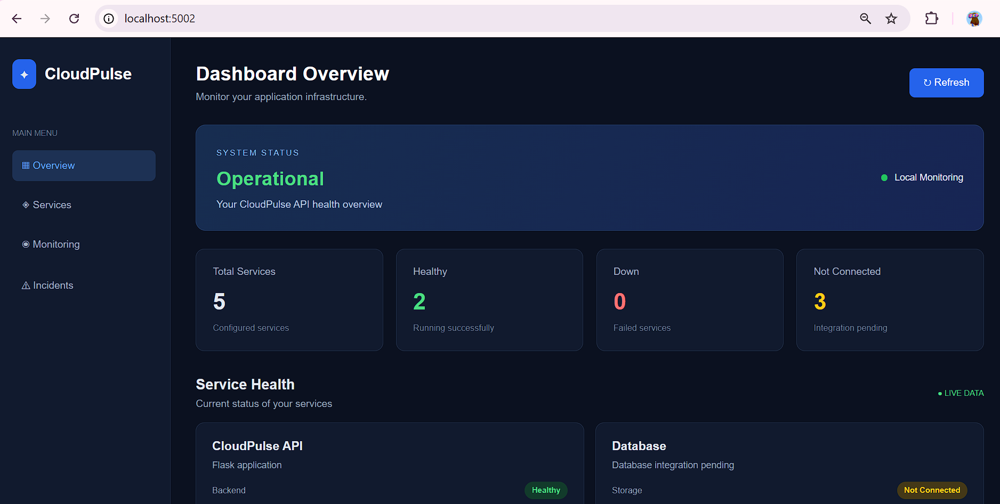
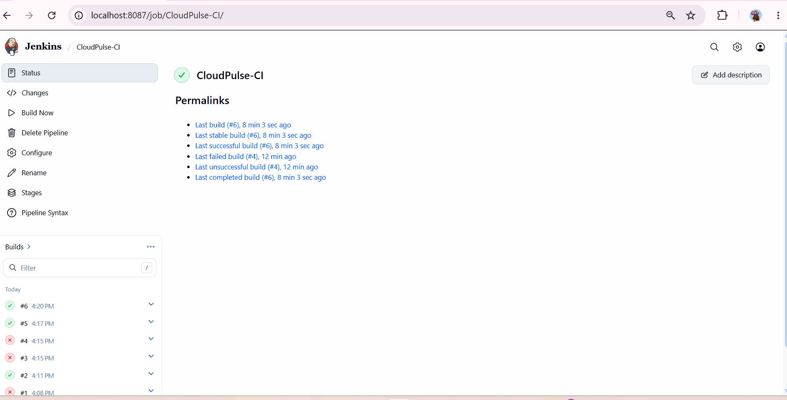
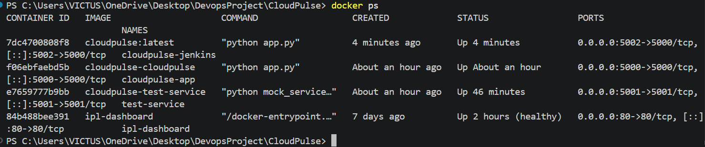
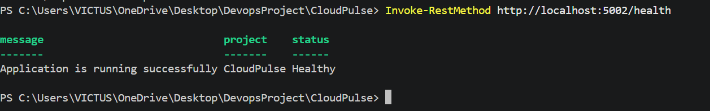

# ☁️ CloudPulse – Smart Cloud Monitoring & Incident Management Platform

CloudPulse is a Python Flask-based web application designed to monitor service health, detect failures, track incidents, and maintain notification history through a centralized dashboard.

The project uses Docker and Docker Compose to run the application and its test service in separate containers. Jenkins is integrated to automate source code checkout, Python validation, Docker environment verification, and Docker image building.

This project demonstrates practical Cloud and DevOps concepts through hands-on implementation.

## 🎯 Project Objectives

- Monitor application and service health.
- Detect service failures automatically.
- Create and track incidents.
- Generate alerts when services go down.
- Track service recovery.
- Display monitoring information through a centralized dashboard.
- Implement containerization and CI practices.

## 🚀 Features Implemented

- **Monitoring Dashboard:** Displays overall system status and service information.
- **HTTP Health Check:** Monitors a test service through an HTTP health endpoint.
- **Incident Management:** Automatically creates incidents when the monitored service goes down.
- **Incident Resolution:** Detects service recovery and resolves open incidents.
- **Notification History:** Stores service-down and recovery notifications.
- **Auto Refresh:** Updates dashboard information every 10 seconds.
- **SQLite Database:** Stores incident and notification records.
- **Docker Containerization:** Runs CloudPulse and Test Service in separate containers.
- **Docker Compose:** Manages multiple containers through a single configuration file.
- **Docker Networking:** Enables communication between containers using service names.
- **Jenkins CI Pipeline:** Automates source code checkout, Python setup, code validation, Docker verification, and image building.

## 🛠️ Technology Stack

| Category             | Technologies          |
| -------------------- | --------------------- |
| Backend              | Python, Flask         |
| Frontend             | HTML, CSS, JavaScript |
| Database             | SQLite                |
| HTTP Monitoring      | Python Requests       |
| Containerization     | Docker                |
| Container Management | Docker Compose        |
| CI Automation        | Jenkins               |
| Version Control      | Git, GitHub           |

## 🏗️ Project Architecture

```text
                 Developer
                     |
                     v
                  GitHub
                     |
                     v
                  Jenkins
                     |
             CI Pipeline Execution
                     |
          +----------+----------+
          |          |          |
       Checkout   Validation  Docker Build
                                 |
                                 v
                         Docker Image
                                 |
                                 v
                         CloudPulse App
                                 |
                          Flask Backend
                                 |
                          HTTP Health Check
                                 |
                                 v
                            Test Service
                                 |
                           Docker Network

                         Flask Backend
                                 |
                                 v
                          SQLite Database
                            /         \
                           v           v
                       Incidents  Notifications
                            \         /
                             v       v
                           Dashboard
```

### Docker Architecture

- `cloudpulse` – Flask monitoring application running on port 5000.
- `test-service` – Flask test service running on port 5001.
- Both containers communicate through the Docker Compose default network.
- CloudPulse accesses the test service using `http://test-service:5001/health`.

## 📂 Project Structure

```text
CloudPulse/
│
├── app.py
├── mock_service.py
├── requirements.txt
├── Dockerfile
├── Dockerfile.test
├── docker-compose.yml
├── .dockerignore
├── .gitignore
├── Jenkinsfile
├── README.md
│
├── screenshots/
│   ├── dashboard.png
│   ├── jenkins-build.png
│   ├── docker-containers.png
│   └── health-check.png
│
├── templates/
│   └── index.html
│
└── static/
    ├── css/
    │   └── style.css
    └── js/
        └── script.js
```

## ⚙️ Run Locally

### 1. Clone the repository

```bash
git clone https://github.com/Patil-Aditi/CloudPulse.git
cd CloudPulse
```

### 2. Create a virtual environment

```powershell
py -m venv venv
```

### 3. Activate the environment

```powershell
.\venv\Scripts\Activate.ps1
```

### 4. Install dependencies

```bash
pip install -r requirements.txt
```

### 5. Start the Test Service

Open a separate terminal:

```bash
py mock_service.py
```

### 6. Start CloudPulse

In the project terminal:

```bash
py app.py
```

### 7. Open the dashboard

Visit:

http://127.0.0.1:5000

## 🐳 Run Using Docker Compose

Make sure Docker Desktop is running.

### 1. Build and start containers

```bash
docker compose up --build -d
```

### 2. Check running containers

```bash
docker compose ps
```

### 3. Access CloudPulse Dashboard

http://127.0.0.1:5000

### 4. Access Test Service

http://127.0.0.1:5001/health

### 5. View application logs

```bash
docker compose logs -f
```

### 6. Stop containers

```bash
docker compose down
```

## 🔄 Jenkins CI Pipeline

Jenkins is configured to automate the CloudPulse Continuous Integration workflow using the `Jenkinsfile` stored in the GitHub repository.

### Pipeline Stages

1. **Checkout:** Retrieves the latest source code from GitHub.
2. **Python Setup:** Verifies Python and installs project dependencies in a virtual environment.
3. **Code Validation:** Checks Python syntax using `py_compile`.
4. **Docker Environment Check:** Verifies Docker CLI and Docker Engine availability.
5. **Docker Image Build:** Builds the CloudPulse Docker image.

### CI Pipeline Result

The Jenkins pipeline completed successfully.

- GitHub source code checkout: Successful
- Python environment setup: Successful
- Python syntax validation: Successful
- Docker environment verification: Successful
- Docker image build: Successful

### Docker Image

```bash
docker images cloudpulse
```

Image built successfully:

```text
cloudpulse:latest
```

The Jenkins-built Docker image was also manually run in a separate container and verified through the application dashboard and health endpoint.

## 🧪 Testing

### Service Health Testing

- Start both applications and verify that Test Service shows Healthy.
- Stop the test service:

```bash
docker compose stop test-service
```

- Verify that CloudPulse detects the failure.
- Check that an incident and a critical notification are created.
- Restart the test service:

```bash
docker compose start test-service
```

- Verify that the service becomes Healthy.
- Confirm that the incident is resolved and a recovery notification appears.

### Application Health Check

```powershell
Invoke-RestMethod http://localhost:5002/health
```

Expected response:

```text
message                             project
-------                             -------
Application is running successfully CloudPulse
```

## 📸 Project Screenshots

### CloudPulse Dashboard



### Jenkins CI Build



### Docker Containers



### Application Health Check



## 🔮 Future Enhancements / Roadmap

- [x] Flask monitoring dashboard
- [x] HTTP health checks
- [x] Incident management and resolution
- [x] Notification history
- [x] Docker containerization
- [x] Docker Compose
- [x] Docker networking
- [x] Jenkins CI pipeline
- [x] Docker image build through Jenkins
- [ ] Automated container health testing in Jenkins
- [ ] Kubernetes deployment
- [ ] Google Kubernetes Engine (GKE) deployment
- [ ] Cloud monitoring integration
- [ ] Real database and cache health monitoring
- [ ] Background worker monitoring
- [ ] Advanced alerting and monitoring features

## 📌 Project Status

**Version 1 – Core Monitoring and CI Implementation Completed**

The core monitoring dashboard, incident management workflow, Docker containerization, and Jenkins CI image build have been implemented and verified.

Further infrastructure integrations and automated deployment features are planned for future versions.

## 👩‍💻 Author

**Aditi Patil**

- GitHub: https://github.com/Patil-Aditi
- Project Repository: https://github.com/Patil-Aditi/CloudPulse
